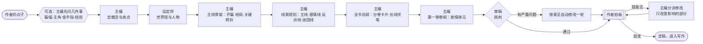
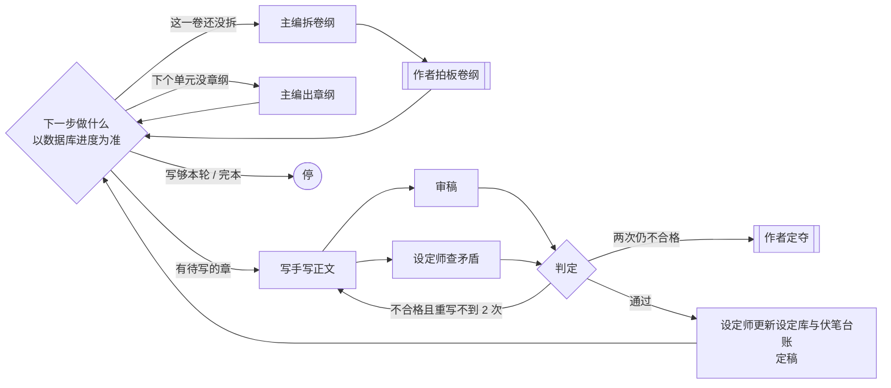
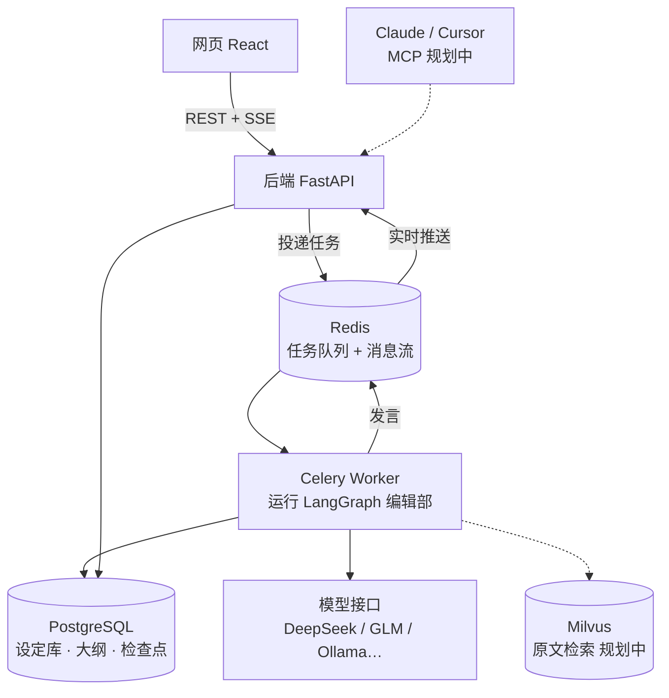

# 执笔 · 多 Agent 长篇小说创作平台

给 AI 编辑部一个点子，主编、设定师、写手、审稿分工协作，把它变成一本完整的长篇小说；作者只在关键节点拍板。

- **AI 编辑部**：主编、设定师、写手、审稿四角色，基于 LangGraph 编排；从点子一路写到完本
- **分层滚动规划**：开书只定全书总纲（线索 + 分卷卡片），每卷写到之前再拆卷纲，每个单元写到之前再出章纲
- **设定库与伏笔台账**：人物、关系、世界观、线索、伏笔；每章定稿后自动更新人物状态和伏笔进展
- **作者拍板**：开书方案、每一卷的卷纲、新书前 3 章试读、两轮重写仍不过的章节，都停下来等作者
- **断点续跑**：按流程节点保存检查点，支持失败后继续；节点内部中断仍可能重试模型调用

> 当前进度：第 1 步完成；第 2 步「编辑部写章节」主体已完成（分层滚动规划、逐章写审、设定库自动更新），演示模式可一路写完第一卷。完整路线见文末。
>
> 2026-10-14 接力盘点见 [项目交接记录](docs/项目交接记录.md)；其中「方案重存丢字段」已在 2026-10-15 修复（改为按名称/序号逐条对齐的增量保存）。

## 编辑部如何开一本新书



- 由粗到细：先定开头和结局，再定关键转折，再把全书拆成几条线（主线、每位女主一条感情线、反派阶梯、谜团、成长），然后写分卷卡片（舞台、对手、实力区间、推进哪些线）和长线伏笔，最后只把第一卷拆成剧情单元；后面各卷写到之前再拆。
- 作者随时可以插话：每做完一步，主编先读新的插话，已完成的部分需要改就排进计划（并联动下游），之后每一步都把作者的话当作必须落实的要求。插话不会打断正在进行的那一步。
- 改了上游会联动检查下游：概念 → 设定 → 主线 → 线索 → 总纲 → 第一卷卷纲（`cascade` 规则）。
- 作者提意见时，会读取数据库中的当前版本作为修改依据；保存按人名、卷号、单元号、伏笔编号逐条对齐，作者单独维护的字段（别名、备注、存活状态、伏笔状态）不会被冲掉。

## 编辑部如何写一本书



- 每次只规划一小段：卷纲只拆当前这一卷，章纲只出当前这个单元，所以能写得细，也能根据已经写出的内容调整。
- 上下文工程：每一步只给模型用得上的部分——本卷卡片和前后几卷的线索节拍、最近几章的摘要、上一章结尾、出场人物的当前状态、与本段相关的伏笔，以及前面用过的高潮与破局方式（防止套路重复）。
- 伏笔台账：每条伏笔有编号（F1、F2……）、跨度（短/中/长）和计划埋下、回收的卷；卷纲和章纲按台账安排动作，章节定稿后设定师把实际埋下、提醒、回收的情况记回台账。
- 一轮写多少由作者选：写 N 章、写完这一卷或一直写到完本（每卷开写前仍会停下来请作者拍板卷纲）；新书写完前 3 章请作者试读一次，意见记入之后每一章的要求。

## 架构



| 设计点 | 做法 |
|---|---|
| 多 Agent 编排 | LangGraph `StateGraph`：条件路由决定下一步、修改队列驱动联动修改 |
| 人工审批 | `interrupt()` 暂停等待作者，`Command(resume=...)` 带着决定恢复 |
| 断点续跑 | `AsyncPostgresSaver` 检查点；Celery `acks_late` + 带心跳的任务锁及启动恢复扫描，异常恢复边界见交接记录 |
| 实时会议室 | 发言写入 PostgreSQL（可回放）并推入 Redis Stream；SSE 先补发历史再推实时消息，断线按 `Last-Event-ID` 补齐 |
| 结构化输出 | 各角色产出均为 Pydantic 模型；优先工具调用，失败自动改用 JSON 模式；宽松解析常见格式错误；识别输出截断并给出明确提示 |
| 模型路由 | 每个角色可分配不同模型配置；API Key 用 Fernet 加密存储；记录每次调用的耗时与 token |
| 演示模式 | 内置不联网的演示模型，无 API Key 也能跑通全流程，同时用于自动化测试 |

## 技术栈

**后端**：Python 3.12 · FastAPI · Pydantic v2 · SQLAlchemy 2（async / psycopg3）· Alembic · LangGraph · LangChain OpenAI · Celery · Redis · PostgreSQL
**前端**：React 19 · TypeScript · Vite · Tailwind CSS 4 · TanStack Query
**工程**：Docker Compose · pytest · ruff · GitHub Actions

## 快速开始（Windows）

需要：Docker Desktop、[uv](https://docs.astral.sh/uv/)、Node.js 24。

1. 打开 Docker Desktop。
2. 双击 `启动.cmd`：自动生成 `.env`、启动数据库、升级表结构、启动后端 / 后台任务 / 网页，并打开 http://127.0.0.1:4320 。
3. 在「模型设置」添加模型（不添加时使用演示模式）。关闭时双击 `停止.cmd`。

**模型建议**
- DeepSeek、智谱 GLM、通义、Kimi 等 OpenAI 兼容接口都可以直接用。
- 本地 Ollama：默认上下文只有 4096，开书会被截断。请创建大上下文版本，并把推理强度设为 `none` 关闭思考：
  ```bash
  curl http://127.0.0.1:11434/api/create -d '{"model":"qwen3.5-4b-16k","from":"qwen3.5:4b","parameters":{"num_ctx":16384}}'
  ```

**全部用 Docker 运行**（需要能拉取镜像）：`docker compose --profile full up -d --build`

## 开发

```bash
docker compose up -d postgres redis          # 基础设施
cd backend
uv sync
uv run alembic upgrade head
uv run uvicorn app.main:app --reload --loop asyncio:SelectorEventLoop   # Windows 需要指定事件循环
uv run celery -A app.worker.celery_app worker -P solo -l info           # 另开终端
uv run pytest                                # 测试（自动创建 zhibi_test 库）
uv run ruff check . && uv run ruff format --check .

cd ../frontend
npm install
npm run dev                                  # http://127.0.0.1:4320，/api 代理到 8000
```

## 目录结构

```
backend/
  app/
    agents/      编辑部角色：结构化产出定义、上下文整理、各角色的一次发言
    graphs/      LangGraph 流程图（开书、写书主循环）与运行时依赖
    llm/         模型路由、结构化输出与重试、演示模型
    prompts/     各角色人设与任务提示词（Markdown）
    services/    任务执行器、会议室消息、方案存取、写作上下文与入库
    api/         REST 与 SSE 接口
    models/      数据表
    worker/      Celery
  alembic/       数据库迁移
  tests/         流程、接口与 SSE 测试
frontend/src/
  pages/book/    会议室、拍板面板、线索、卷纲、正文目录与阅读、设定库
docs/设计说明.md  设计依据
```

## 路线

1. ✅ **地基 + 开新书**：编辑部开书流程、作者拍板、断点续跑、实时会议室、设定库与大纲编辑
2. ✅ **编辑部写章节**：分层滚动规划（线索 → 总纲 → 卷纲 → 章纲）、并行审稿与查矛盾、退稿重写、试读拍板、连写多章、中途插话、设定库与伏笔台账自动更新
   - 下一步提质：题材打法库（套路与节奏、防重复规则）、单元纲多方案比稿、专项审稿（反派智商、爽点节奏、伏笔）
3. ⬜ **旧书导入 + 原文检索**：TXT 分章、并行通读建库、Milvus 混合检索与重排、带出处的设定问答
4. ⬜ **评测 + Langfuse**：设定问答评测集、矛盾检测评测集，跑 → 分析 → 改进 → 再跑
5. ⬜ **MCP 服务**：在 Claude / Cursor 中查设定、问剧情、触发写作
6. ⬜ **上线**：免注册演示站
