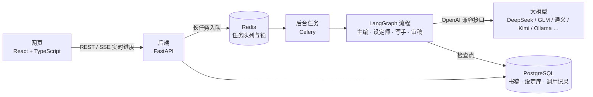

# 执笔 · 多 Agent 长篇小说创作平台

给 AI 编辑部一个点子，主编、设定师、写手、审稿四个角色分工协作，把它写成一本长篇小说；作者只在关键节点拍板。也可以导入一整本小说「拆书」，自动整理出大纲、设定和写法亮点，供写作时参考。

> 个人项目，仍在开发中。程序在本机运行，模型用你自己的 API Key（任意 OpenAI 兼容接口）；不填 Key 时可以用内置的演示模式走通全流程。

## 主要功能

- **多 Agent 编辑部**：基于 LangGraph 编排主编、设定师、写手、审稿四个 Agent，从开书、规划、写章节到审稿退稿自动推进。
- **作者拍板**：开书方案、下一段规划、卷纲、新书试读、反复不过的章节都会停下来等作者确认；流程按节点存检查点，中断或重启后可以从断点继续。
- **分层滚动规划**：开书只定第一段和全书方向，近处写细、远处留方向；写到哪一段再规划哪一段，卷纲多方案比稿，并做专项审稿。
- **设定库与长篇记忆**：人物、关系、世界、伏笔、信息差等设定随每章定稿自动更新；写作时带分层前情提要（卷回顾 → 单元回顾 → 最近几章），保持长篇前后一致。
- **主编对话与工具调用**：作者可以直接和主编聊。主编通过 Function Calling 查设定库、查大纲、读章节、搜正文、翻拆过的书、联网搜索，也能按作者的话修改书稿（改动可撤销）；支持可管理的「手册」（Skill）和长期记忆。
- **拆书**：导入整本小说 TXT，自动分卷分章，结构化抽取大纲、角色与设定、写法亮点，每条结论附章节出处。
- **提示词管理与调用记录**：各角色的提示词可在网页里查看、修改和恢复默认；每次模型调用的输入、输出、耗时和用量都有记录，方便排查效果问题。
- **导出**：已定稿的章节按卷、按章导出 TXT。

## 架构



- 开书、写书这类长任务交给 Celery 在后台跑，Redis 负责排队和防止同一本书重复开跑；网页通过 SSE 实时看到编辑部在做什么。
- LangGraph 的检查点存在 PostgreSQL 里，需要作者拍板时流程暂停，作者确认后从原处继续。
- 模型 API Key 用本机生成的密钥加密后存进数据库，不写进代码或配置文件。

## 技术栈

- **后端**：Python 3.12、FastAPI、LangGraph、LangChain（langchain-openai）、SQLAlchemy + Alembic、PostgreSQL、Celery + Redis、SSE
- **前端**：React、TypeScript、Vite、Tailwind CSS、TanStack Query、CodeMirror
- **测试**：pytest（后端）、Node 原生测试 + Playwright（前端）

## 快速开始（Windows）

需要先装好：[Docker Desktop](https://www.docker.com/products/docker-desktop/)、[uv](https://docs.astral.sh/uv/)、Node.js 24。

1. 克隆仓库，打开 Docker Desktop。
2. 双击 `启动.cmd`。它会自动生成 `.env`（含加密 API Key 用的密钥）、在 Docker 里启动 PostgreSQL 和 Redis、升级数据库表结构、启动后端 / 后台任务 / 网页，并打开 http://127.0.0.1:4320 。
3. 在「设置 → 模型」里添加模型：填接口地址、模型名和你自己的 API Key。DeepSeek、智谱 GLM、通义、Kimi 等 OpenAI 兼容接口都可以直接用。不添加模型时使用演示模式。
4. 用完双击 `停止.cmd`。

**用本地 Ollama**：Ollama 默认上下文只有 4096，开书会被截断。请先创建大上下文版本，并在模型设置里把推理强度设为 `none` 关闭思考：

```bash
curl http://127.0.0.1:11434/api/create -d '{"model":"qwen3.5-4b-16k","from":"qwen3.5:4b","parameters":{"num_ctx":16384}}'
```

## 开发

```bash
docker compose up -d postgres redis          # 数据库和 Redis
cd backend
uv sync
uv run alembic upgrade head
uv run uvicorn app.main:app --reload --loop asyncio:SelectorEventLoop   # Windows 需要指定事件循环
uv run celery -A app.worker.celery_app worker -P solo -l info           # 另开终端
uv run pytest                                # 测试（自动创建 zhibi_test 库）

cd ../frontend
npm install
npm run dev                                  # http://127.0.0.1:4320，/api 代理到 8000
npm run test:workspace
```

## 目录结构

```
backend/
  app/
    agents/      编辑部各角色：结构化产出定义、上下文整理
    graphs/      LangGraph 流程（开书、写书主循环）
    llm/         模型路由、结构化输出与重试、演示模型
    prompts/     各角色的提示词（Markdown）；skills/ 是主编的手册
    services/    任务执行、主编对话与工具、拆书、写作上下文
    api/         REST 与 SSE 接口
    models/      数据表
    worker/      Celery 后台任务
  alembic/       数据库迁移
  tests/         后端测试
frontend/src/    网页
docs/
  设计说明.md     整体设计
  codex任务/      每一步开发的任务说明
  拆书/ 主编聊天/  拆书与主编对话的设计和试验脚本
scripts/         一键启动、停止、数据库备份
```
