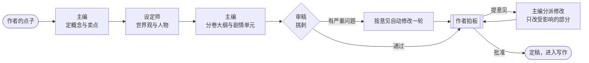
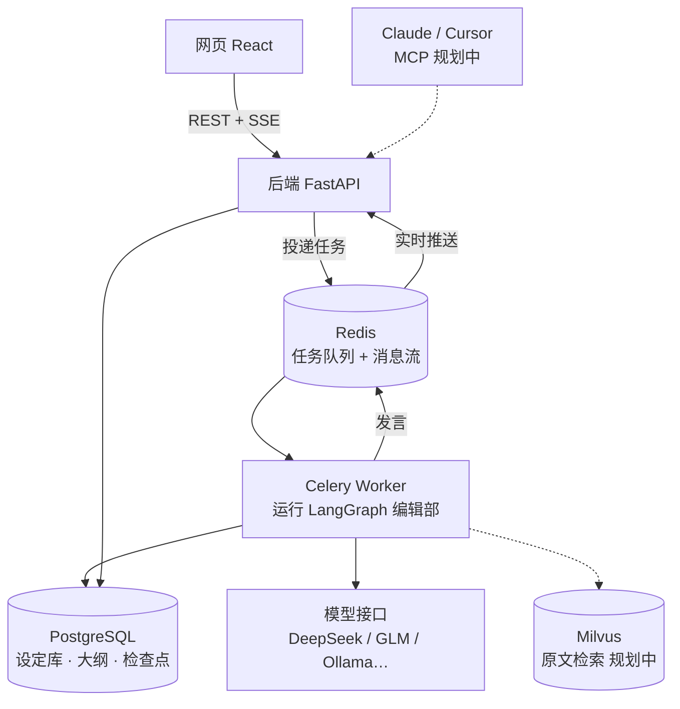

# 执笔 · 多 Agent 长篇小说创作平台

给 AI 编辑部一个点子，主编、设定师、写手、审稿分工协作，把它变成一本完整的长篇小说；作者只在关键节点拍板。

- **AI 编辑部**：四个角色各司其职，基于 LangGraph 编排，会议过程实时直播
- **设定库**：人物、关系、世界观、伏笔随写作维护，保证长篇前后一致
- **作者拍板**：流程在关键节点暂停等待作者批准或提意见；作者可直接修改任何设定和大纲
- **断点续跑**：每一步都存检查点，出错或重启后从中断处继续，不重复调用模型

> 当前进度：第 1 步「地基 + 开新书」已完成。完整路线见文末。

## 编辑部如何开一本新书



- 改了概念会联动修改设定和大纲，改了设定会联动检查大纲（`cascade` 规则）。
- 作者提意见时，以数据库中的当前版本为准，作者手动改过的内容不会被覆盖。

## 架构



| 设计点 | 做法 |
|---|---|
| 多 Agent 编排 | LangGraph `StateGraph`：条件路由决定下一步、修改队列驱动联动修改 |
| 人工审批 | `interrupt()` 暂停等待作者，`Command(resume=...)` 带着决定恢复 |
| 断点续跑 | `AsyncPostgresSaver` 检查点；Celery `acks_late` + 带心跳的任务锁，worker 崩溃后自动从检查点恢复 |
| 实时会议室 | 发言写入 PostgreSQL（可回放）并推入 Redis Stream；SSE 先补发历史再推实时消息，断线按 `Last-Event-ID` 补齐 |
| 结构化输出 | 各角色产出均为 Pydantic 模型；优先工具调用，失败自动改用 JSON 模式；宽松解析常见格式错误；识别输出截断并给出明确提示 |
| 模型路由 | 每个角色可分配不同模型配置；API Key 用 Fernet 加密存储；记录每次调用的耗时与 token |
| 演示模式 | 内置不联网的演示模型，无 API Key 也能跑通全流程，同时用于自动化测试 |

## 技术栈

**后端**：Python 3.12 · FastAPI · Pydantic v2 · SQLAlchemy 2（async / psycopg3）· Alembic · LangGraph · LangChain OpenAI · Celery · Redis · PostgreSQL
**前端**：React 19 · TypeScript · Vite · Tailwind CSS 4 · TanStack Query
**工程**：Docker Compose · pytest · ruff · GitHub Actions

## 快速开始（Windows）

需要：Docker Desktop、[uv](https://docs.astral.sh/uv/)、Node.js 24。

1. 打开 Docker Desktop。
2. 双击 `启动.cmd`：自动生成 `.env`、启动数据库、升级表结构、启动后端 / 后台任务 / 网页，并打开 http://127.0.0.1:4320 。
3. 在「模型设置」添加模型（不添加时使用演示模式）。关闭时双击 `停止.cmd`。

**模型建议**
- DeepSeek、智谱 GLM、通义、Kimi 等 OpenAI 兼容接口都可以直接用。
- 本地 Ollama：默认上下文只有 4096，开书会被截断。请创建大上下文版本，并把推理强度设为 `none` 关闭思考：
  ```bash
  curl http://127.0.0.1:11434/api/create -d '{"model":"qwen3.5-4b-16k","from":"qwen3.5:4b","parameters":{"num_ctx":16384}}'
  ```

**全部用 Docker 运行**（需要能拉取镜像）：`docker compose --profile full up -d --build`

## 开发

```bash
docker compose up -d postgres redis          # 基础设施
cd backend
uv sync
uv run alembic upgrade head
uv run uvicorn app.main:app --reload --loop asyncio:SelectorEventLoop   # Windows 需要指定事件循环
uv run celery -A app.worker.celery_app worker -P solo -l info           # 另开终端
uv run pytest                                # 测试（自动创建 zhibi_test 库）
uv run ruff check . && uv run ruff format --check .

cd ../frontend
npm install
npm run dev                                  # http://127.0.0.1:4320，/api 代理到 8000
```

## 目录结构

```
backend/
  app/
    agents/      编辑部角色：结构化产出定义、上下文整理、各角色的一次发言
    graphs/      LangGraph 流程图（开书）与运行时依赖
    llm/         模型路由、结构化输出与重试、演示模型
    prompts/     各角色人设与任务提示词（Markdown）
    services/    任务执行器、会议室消息、方案存取
    api/         REST 与 SSE 接口
    models/      数据表
    worker/      Celery
  alembic/       数据库迁移
  tests/         流程、接口与 SSE 测试
frontend/src/
  pages/book/    会议室、拍板面板、大纲、设定库
docs/设计说明.md  设计依据
```

## 路线

1. ✅ **地基 + 开新书**：编辑部开书流程、作者拍板、断点续跑、实时会议室、设定库与大纲编辑
2. ⬜ **编辑部写章节**：并行审稿与查矛盾、退稿重写、试读拍板、连写多章、中途插话、设定库自动更新
3. ⬜ **旧书导入 + 原文检索**：TXT 分章、并行通读建库、Milvus 混合检索与重排、带出处的设定问答
4. ⬜ **评测 + Langfuse**：设定问答评测集、矛盾检测评测集，跑 → 分析 → 改进 → 再跑
5. ⬜ **MCP 服务**：在 Claude / Cursor 中查设定、问剧情、触发写作
6. ⬜ **上线**：免注册演示站
