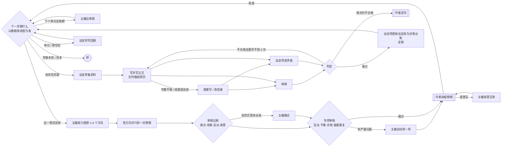
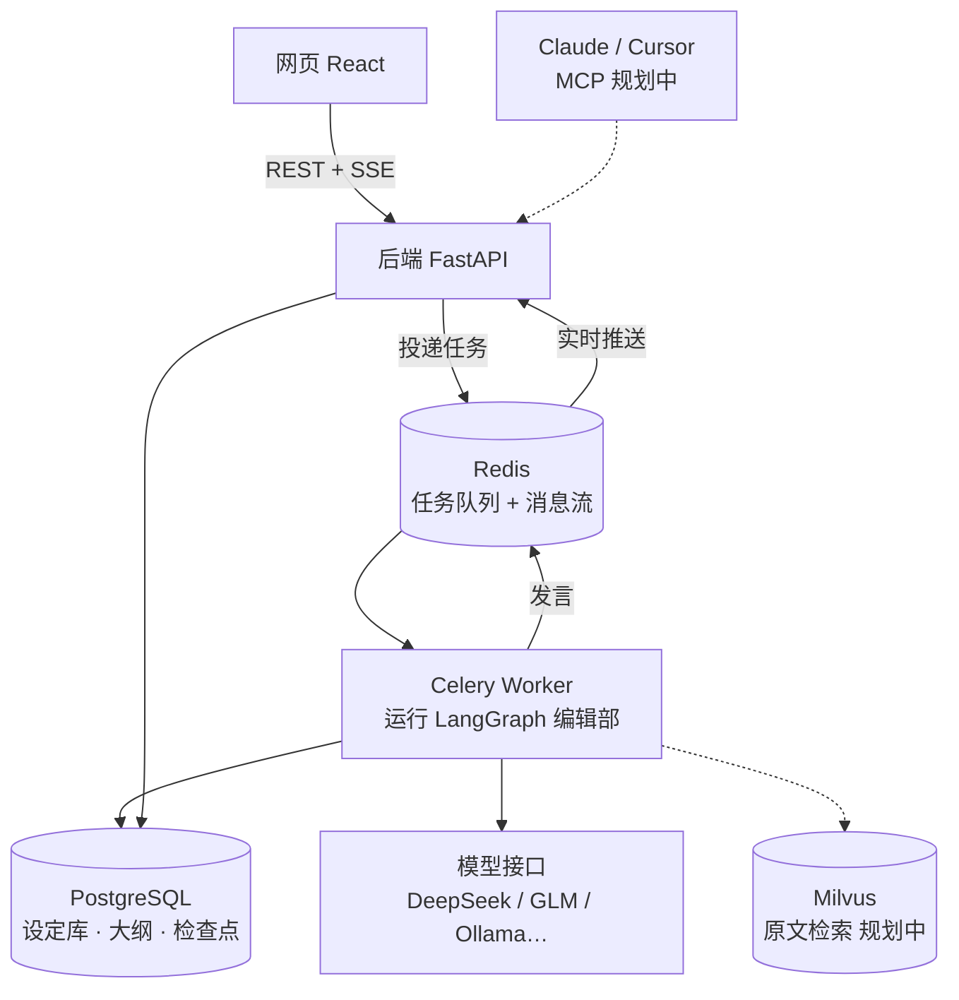

# 执笔 · 多 Agent 长篇小说创作平台

给 AI 编辑部一个点子，主编、设定师、写手、审稿分工协作，把它变成一本完整的长篇小说；作者只在关键节点拍板。

- **AI 编辑部**：主编、设定师、写手、审稿四角色，基于 LangGraph 编排；从点子一路写到完本
- **分层滚动规划**：开书只定全书总纲（线索 + 分卷卡片），每卷写到之前再拆卷纲，每个单元写到之前再出章纲
- **规划质量**：按题材选打法库（套路与节奏、防重复规则）注入各层规划；每卷卷纲由主编出 2-3 份不同方向的方案比稿，再经专项审稿（反派智商、爽点节奏、伏笔排期、套路重复）和自动修改后才交给作者
- **写章节**：写之前设定师读章纲、从设定库和前文里挑资料；伏笔回收时把当初埋下那一章的原文片段交给写手；字数不够自动续写、结尾写成总结自动改写；写手写到哪了，阅读页和会议室实时看得到
- **长篇记忆**：每个单元写完写单元回顾，每卷写完写卷回顾；后面的规划和写作带分层的前情提要（各卷回顾 → 本卷各单元回顾 → 最近几章），总长有上限
- **设定库与伏笔台账**：人物、关系、世界观、线索、伏笔；每章定稿后自动更新人物状态和伏笔进展，并记下改了什么，作者让某一章按意见重写时能撤销再重新提取
- **导出**：一键把已定稿的章节按卷、按章导出成 TXT
- **作者拍板**：开书方案、每一卷的卷纲、新书前 3 章试读、两轮重写仍不过的章节，都停下来等作者
- **断点续跑**：按流程节点保存检查点，支持失败后继续；节点内部中断仍可能重试模型调用

> 当前进度：第 1 步完成；第 2 步「编辑部写章节」完成（分层滚动规划、逐章写审、设定库自动更新，题材打法库、卷纲比稿、专项审稿，以及写章节提质：备资料、伏笔回收带原文、续写与改结尾、单元/卷回顾、按意见重写、导出 TXT、实时显示），演示模式可一路写完第一卷并拆第二卷。还没有用真模型长篇试写过。完整路线见文末。
>
> 2026-10-14 接力盘点见 [项目交接记录](docs/项目交接记录.md)；其中「方案重存丢字段」已在 2026-10-15 修复（改为按名称/序号逐条对齐的增量保存）。
>
> 2026-10-16 第一包任务 1「数据底座」已接入：关键节点、人物锚点、信息差、伏笔／期待共用台账、编辑批注、术语表与开书进度。默认仍是「一口气出方案」，没有提前启用逐块确认或改变开书／写作流程。迁移与验证范围见 [第一包验收](docs/第一包验收.md)。

## 书的工作台：宣纸书房

- **三栏常驻**：左侧 248px 是 QQ 式编辑部联系人和书稿目录；中间是群聊／点名私聊；右侧是概览、设定、大纲与正文。切书稿页面不会丢失当前会话或输入草稿。
- **讨论优先**：中栏默认占讨论与稿件总宽的 42%，拖动分隔线可调宽（最小 360px），宽度比例会保存；双击恢复默认，也支持方向键调整。低于 1280px 左栏收为 64px 图标栏，点击展开浮层；低于 1024px 用顶栏「讨论 / 稿件」切换。
- **跟随与拍板**：右栏跟随当前开书产出、实时正文和待拍板对象；点击目录／产出／正文链接后停止跟随，点击「回到正在进行的」恢复。跟随不增加浏览器历史。顶栏用一句话显示进度，不再显示九步进度条。待办固定在会话顶部，拍板按钮只在稿件顶部出现。
- **群聊与点名插话**：群聊使用角色气泡与可展开产出卡片；私聊显示该角色的点名消息，并可切换显示他的群聊发言。每本书、每个会话分别保存已读位置，作者自己的消息不计未读。快捷短语只填入草稿，不直接发送。
- **不是“真私聊代理”**：私聊只是点名给某角色的作者要求，仍由既有编辑部流程处理，不会绕过拍板直接改稿。工作／提问时排入插话；等拍板时发送修改意见；空闲或不读插话的重写任务中立即记入作者要求，并回复「记下了，下次开工就照办。」。
- **素净书页**：正文不套白卡片，宋体 17px、双倍行高；章纲／资料／审稿／摘要从稿件右侧的 420px 抽屉打开，不挡会话。修改、按意见重写及本章导出收进「…」菜单。右侧页面依自身宽度调整列数。
- 开书尚未存库的产出用只读的「本轮产出 · 未定稿」预览展示，不冒充正式稿，也不会写入可编辑的数据缓存。`/books/{id}/meeting` 旧链接重定向到概览，历史消息仍保留在群聊。

设置改版已接入居中设置弹窗、单书设置、提示词与调用记录，以及宣纸／墨色／跟随系统外观。真私聊自主改稿、独立纯阅读模式仍不在本轮范围。

## 编辑部如何开一本新书


- 由粗到细：先定开头和结局，再定关键转折，再把全书拆成几条线（主线、每位女主一条感情线、反派阶梯、谜团、成长），然后写分卷卡片（舞台、对手、实力区间、推进哪些线）和长线伏笔，最后只把第一卷拆成剧情单元；后面各卷写到之前再拆。
- 作者随时可以插话：每做完一步，主编先读新的插话，已完成的部分需要改就排进计划（并联动下游），之后每一步都把作者的话当作必须落实的要求。插话不会打断正在进行的那一步。
- 改了上游会联动检查下游：概念 → 设定 → 主线 → 线索 → 总纲 → 第一卷卷纲（`cascade` 规则）。
- 作者提意见时，会读取数据库中的当前版本作为修改依据；保存按人名、卷号、单元号、伏笔编号逐条对齐，作者单独维护的字段（别名、备注、存活状态、伏笔状态）不会被冲掉。
- 主线骨架以 `story_nodes` 为唯一事实来源，书上只保留核心矛盾、主题、成长弧；旧提示词和旧检查点产出的开篇／转折／结局在保存时自动转成节点。主线页仍用竖向时间轴，可就地修改节点名称、发生什么、之前得先有、之后变成，显示铁钉／暂定／留空状态；完整拼图板留到任务 3。
- 人物卡不再单独存秘密，旧秘密转入信息差表（S 编号）；锚点、信息差、伏笔／期待（F／E 共用序号）已有读写接口。信息差专页、期待筛选与写作阶段自动更新规则仍由后续任务接入。
- 提示词页「角色与规矩」新增可编辑的术语表，至少保留 5 个有解释的术语；编辑批注技巧去除表外名称、去重且最多 3 个。本次只搬入术语表，不改已有生成提示词和 schema。

## 编辑部如何写一本书



- 每次只规划一小段：卷纲只拆当前这一卷，章纲只出当前这个单元，所以能写得细，也能根据已经写出的内容调整。
- 题材打法库（`backend/app/prompts/playbooks/`）：按概念里的类型和标签选一套打法，目前有「后宫玄幻爽文」和通用版；里面是常见套路的写法（退婚打脸、扮猪吃虎、拍卖会、秘境、宗门大比、修罗场……）、女主登场节奏、欲扬先抑，以及防重复规则（某个套路、某种破局手法全书最多用几次，不能连着用）。线索规划、总纲、卷纲、章纲各取用得上的几节；章纲只带本单元用到的套路。
- 卷纲比稿：主编默认想 2 个方向（可按力度设为 1-4 个），每个方向并行拆一份完整卷纲；审稿按爽点、线索交织、反派智商、新意打分，选出最好的一份，别的方案有更好的单元就建议融合。会议室里能看到每个方向、每份方案和打分表。
- 专项审稿：只查反派是否降智、爽点节奏、伏笔排期、套路重复。套路超限、连着用同一种破局手法、台账里该在本卷埋下或回收的伏笔没排上，这些由程序直接查（不靠模型）；有严重问题主编自动改一轮，还没改掉的在拍板时列给作者。每个单元都标了套路和破局手法，全书用了几次随时可查。
- 上下文工程：每一步只给模型用得上的部分——本卷卡片和前后几卷的线索节拍、分层的前情提要、上一章结尾、设定师为这一章挑的人物和设定、与本段相关的伏笔，以及前面用过的高潮与破局方式（防止套路重复）。
- 设定师备资料：写每一章之前，设定师读章纲，从人物名单、设定目录和前文目录里挑出这一章用得上的人物、设定条目、要回顾的前文和「最容易写错的地方」，代替按名字匹配；章纲点名的人物和主角总会带上。
- 伏笔回收带原文：章纲要提醒或回收某条伏笔时，从台账查出埋下的那一章，按伏笔描述找出最相关的原文片段（约 300 字）交给写手，让读者能想起当初那一幕。
- 写完先自查：字数不到目标七成就让写手接着写（最多两次），结尾写成「一切才刚刚开始」这类总结就只改写结尾，然后才送审。续写、改结尾都是流式的。
- 长篇记忆：单元写完写单元回顾、一卷写完写卷回顾（存库）；写正文、出章纲、拆卷纲时按「各卷回顾 → 本卷各单元回顾 → 最近几章」带前情，每层有字数上限，超了先压缩最早的。
- 按我的意见重写：已定稿的章节可以在阅读页写下意见让写手重写。会先撤销这一章原来记进设定库和伏笔台账的变化，重写、审稿后再重新提取；后面还有定稿章节时会提示「后面的章节不会跟着改」并要求确认。
- 实时看写作：写手写到哪了每隔一小段推一次（只走 Redis，不进数据库），阅读页和会议室都能看到正文一点点写出来。
- 伏笔台账：每条伏笔有编号（F1、F2……）、跨度（短/中/长）和计划埋下、回收的卷；卷纲和章纲按台账安排动作，章节定稿后设定师把实际埋下、提醒、回收的情况记回台账。
- 一轮写多少由作者选：写 N 章、写完这一卷或一直写到完本（每卷开写前仍会停下来请作者拍板卷纲）；新书写完前 3 章请作者试读一次，意见记入之后每一章的要求。

## 架构



| 设计点 | 做法 |
|---|---|
| 多 Agent 编排 | LangGraph `StateGraph`：条件路由决定下一步、修改队列驱动联动修改 |
| 人工审批 | `interrupt()` 暂停等待作者，`Command(resume=...)` 带着决定恢复 |
| 断点续跑 | `AsyncPostgresSaver` 检查点；Celery `acks_late` + 带心跳的任务锁及启动恢复扫描，异常恢复边界见交接记录 |
| 实时会议室 | 发言写入 PostgreSQL（可回放）并推入 Redis Stream；SSE 先补发历史再推实时消息，断线按 `Last-Event-ID` 补齐；写手的正文增量作为 `draft` 事件只走 Redis，每条带到目前为止的全文，中途打开页面也能接上 |
| 可撤销的设定更新 | 每章定稿时把对人物状态、伏笔台账的改动（改前、改后）记在章节上；重写时只改回「仍是这一章改成的样子」的字段，后面章节改过的不动 |
| 结构化输出 | 各角色产出均为 Pydantic 模型；优先工具调用，失败自动改用 JSON 模式；宽松解析常见格式错误；识别输出截断并给出明确提示 |
| 模型路由 | 每个角色可分配不同模型配置；API Key 用 Fernet 加密存储；记录每次调用的耗时与 token |
| 演示模式 | 内置不联网的演示模型，无 API Key 也能跑通全流程，同时用于自动化测试 |

## 技术栈

**后端**：Python 3.12 · FastAPI · Pydantic v2 · SQLAlchemy 2（async / psycopg3）· Alembic · LangGraph · LangChain OpenAI · Celery · Redis · PostgreSQL
**前端**：React 19 · TypeScript · Vite · Tailwind CSS 4 · TanStack Query
**工程**：Docker Compose · pytest · ruff · GitHub Actions

## 快速开始（Windows）

需要：Docker Desktop、[uv](https://docs.astral.sh/uv/)、Node.js 24。

1. 打开 Docker Desktop。
2. 双击 `启动.cmd`：自动生成 `.env`、启动数据库、升级表结构、启动后端 / 后台任务 / 网页，并打开 http://127.0.0.1:4320 。
3. 在顶栏「设置 → 模型」添加模型（不添加时使用演示模式）。关闭时双击 `停止.cmd`。

**模型建议**
- DeepSeek、智谱 GLM、通义、Kimi 等 OpenAI 兼容接口都可以直接用。
- 本地 Ollama：默认上下文只有 4096，开书会被截断。请创建大上下文版本，并把推理强度设为 `none` 关闭思考：
  ```bash
  curl http://127.0.0.1:11434/api/create -d '{"model":"qwen3.5-4b-16k","from":"qwen3.5:4b","parameters":{"num_ctx":16384}}'
  ```

**全部用 Docker 运行**（需要能拉取镜像）：`docker compose --profile full up -d --build`

## 开发

```bash
docker compose up -d postgres redis          # 基础设施
cd backend
uv sync
uv run alembic upgrade head
uv run uvicorn app.main:app --reload --loop asyncio:SelectorEventLoop   # Windows 需要指定事件循环
uv run celery -A app.worker.celery_app worker -P solo -l info           # 另开终端
uv run pytest                                # 测试（自动创建 zhibi_test 库）
uv run ruff check . && uv run ruff format --check .

cd ../frontend
npm install
npm run dev                                  # http://127.0.0.1:4320，/api 代理到 8000
npm run test:workspace                       # Node 24 原生测试：跟随、未读、开书临时预览
npx tsc -b && npm run lint && npm run build
```

## 目录结构

```
backend/
  app/
    agents/      编辑部角色：结构化产出定义、上下文整理、各角色的一次发言
    graphs/      LangGraph 流程图（开书、写书主循环）与运行时依赖
    llm/         模型路由、结构化输出与重试、演示模型
    prompts/     各角色人设与任务提示词（Markdown）；playbooks/ 是题材打法库
    services/    任务执行器、会议室消息、方案存取、写作上下文与入库
    api/         REST 与 SSE 接口
    models/      数据表
    worker/      Celery
  alembic/       数据库迁移
  tests/         流程、接口与 SSE 测试
frontend/src/
  pages/book/    会议室、拍板面板、线索、卷纲、正文目录与阅读、设定库
docs/设计说明.md  设计依据
```

## 路线

1. ✅ **地基 + 开新书**：编辑部开书流程、作者拍板、断点续跑、实时会议室、设定库与大纲编辑
2. ✅ **编辑部写章节**：分层滚动规划（线索 → 总纲 → 卷纲 → 章纲）、并行审稿与查矛盾、退稿重写、试读拍板、连写多章、中途插话、设定库与伏笔台账自动更新
   - ✅ 规划提质：题材打法库（套路与节奏、防重复规则）、卷纲多方案比稿、专项审稿（反派智商、爽点节奏、伏笔排期、套路重复）
   - ✅ 写章节提质：设定师备资料、伏笔回收带原文、字数与结尾自查、单元与卷回顾（分层前情）、按作者意见重写已定稿章节、导出 TXT、写作实时显示
3. ⬜ **旧书导入 + 原文检索**：TXT 分章、并行通读建库、Milvus 混合检索与重排、带出处的设定问答
4. ⬜ **评测 + Langfuse**：设定问答评测集、矛盾检测评测集，跑 → 分析 → 改进 → 再跑
5. ⬜ **MCP 服务**：在 Claude / Cursor 中查设定、问剧情、触发写作
6. ⬜ **上线**：免注册演示站


## 设置、提示词与调用记录

书房和书内顶栏的齿轮「设置」打开同一个桌面端 1040 × 760 的居中窗口，较小屏幕自动收缩并保留边距；旧 `/settings` 地址回到书房并自动打开。模型添加／修改是窗口内的表单页，不再叠加弹窗；自动发现模型继续保留。

- **模型**：管理模型连接、测试连接，指定默认及四个编辑角色使用的模型。
- **外观**：宣纸·亮／墨色·暗／跟随系统；宋体／系统楷体／黑体；正文字号 15–20（默认 17）、行距、界面文字、减少动效。存于浏览器 `zhibi:appearance`，刷新保留、立即生效，不上传服务器。正文与稿件使用独立阅读变量，聊天随界面字号变化。
- **新书默认**：写作偏好和编辑部力度，新开书时复制进该书；以后修改默认不会覆盖已有书。
- **用量**：按书和角色汇总调用次数、输入和输出 token，保留历史统计；供应商未返回的用量显示 `—`，不按文本长度估算。

### 本书设置

书稿目录末尾进入 `/books/:bookId/settings`。写作偏好包括书名风格、人称、亲密戏边界、每章字数、其他规矩及题材打法。选定打法会覆盖自动匹配；每章字数覆盖概念中的目标，续写补足字数也用同一目标。所有选项自动保存；文本输入短暂防抖，保存失败保留输入并提供重试。

底部虚线框是后端 `compile_rules` 生成的**实际提示词原文**：先「这本书的写作规矩」，再接「作者的要求」。空项省略，不改写作者填写的其他规矩。运行中仍可改设置：开书写入本任务 note，由主编下一步 intake 消费；写书向群聊发系统消息，后续节点重读数据库。

作者要求唯一来源为 `author_requirements`，可添加、修改和删除；按原文去重，保留来源和时间。来源包括动笔前回答、插话、角色私聊、试读、卷纲意见、手动添加和旧记录。图检查点不再是要求来源，删掉的要求不会在下一次开书步骤或恢复任务时被重新带入。

| 力度 | 最多重写 | 卷纲方案 | 卷纲专项审稿 | 审稿尺度 |
|---|---:|---:|---|---|
| 省时 | 1 | 1 | 关闭 | 宽松 |
| 均衡（默认） | 2 | 2 | 开启 | 标准 |
| 精品 | 3 | 3 | 开启 | 严格 |
| 自定义 | 0–5 | 1–4 | 可选 | 宽松／标准／严格 |

**默认卷纲比稿从原来的 3 个方案改为 2 个。** 仅 1 个方案时不比稿；不做专项审稿就跳过该节点；最多重写为 0 时，第一次不合格直接交作者。卷纲拍板关闭时仍展示卷纲并注明「按设置自动批准」；新书前 3 章试读可单独关闭。审稿尺度仅发给审稿角色，不污染写手或设定检查提示词。

### 提示词与调用记录

设置左下角进入 `/prompts`，分「提示词」「调用记录」两页签。

- 提示词按开书、规划、写作、审稿与入库、角色与规矩、题材打法分组。默认只读，点「自定义」后编辑；未保存草稿保留在当前浏览器会话，切页、切模板和刷新不丢；CodeMirror 原子变量块显示中文名、可插入、不能只删半个。
- 保存严格校验默认变量不能缺、不能多；打法必须通过实际 `playbook.parse()`。修改对所有书生效，`prompt_overrides` 存覆盖文本，恢复默认删除覆盖行。
- 默认文件可以缓存，覆盖内容每次从数据库读取；已有 worker 下一次调用就能读取新版本，无须重启。页面同时提供真实角色／使用时机／自定义状态／最近调用详情。
- 调用记录按书和角色筛选、游标分页。右侧详情按顺序展示系统提示、用户提示、默认折叠的 JSON 结构、模型原样回复、错误。结构化原始 JSON／工具参数、流式完整正文、失败的部分输出和每次重试分开留存，演示模式同样记录。
- 每本书只保留最近 **2000** 次调用的完整 `request`／`response`；更早仅清空这两列，不删统计数据。提示词和原始回复可能包含小说、作者要求等内容，与数据库一起按私人资料备份。

### 数据升级与验证

新增 Alembic `0007_book_settings.py`：`books.settings`、`app_settings`、`author_requirements`；旧要求按原书更新时间迁移后删除 `books.requirements` 列；旧书使用新默认但书名交给主编，不改已有书名。`0008_prompt_overrides_logs.py`：`prompt_overrides` 及 `llm_calls.request/response`；`0009_nullable_usage.py`：未来供应商未返回的 token 用量用 NULL 区分未知与真实 0（历史 0 不改）。升级前备份 PostgreSQL；本轮验收使用独立预览数据库，不自动升级正在使用的书库。

```powershell
$env:NO_PROXY='localhost,127.0.0.1,::1'
cd backend
.venv/Scripts/python.exe -m pytest -q
cd ../frontend
npx tsc -b
npm run lint
npm run build
npm run test:workspace
```

浏览器回归：先另建 PostgreSQL 预览库和 Redis 库，让 API／worker 都指向它们；API 8012、Vite 4332（`ZHIBI_API_URL=http://127.0.0.1:8012`），不配置真实模型即为演示模式。然后在 `frontend` 运行 `npx playwright test`（需要已安装 Playwright 浏览器；也可用 `ZHIBI_CHROMIUM` 指定 Chromium 路径）。测试禁止使用日常 4320 地址，并将截图、trace、HTML 报告写入被忽略的 `data/settings-revision/`。它会创建验收书、恢复新书默认和概念提示词，请只对独立预览库执行。

已暂停在卷纲拍板／试读的任务不会因切换开关自动唤醒；下一次恢复执行时再按新设置跳过该环节。删除作者要求只影响后续提示词，不抹除既有群聊、原始调用记录或既有书稿。
