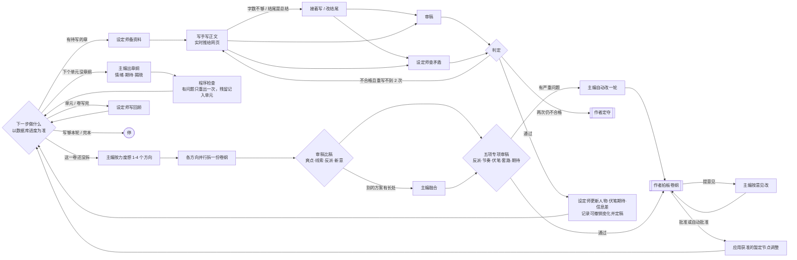
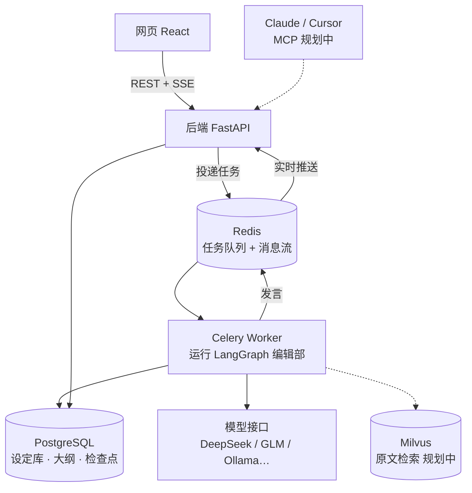

# 执笔 · 多 Agent 长篇小说创作平台

给 AI 编辑部一个点子，主编、设定师、写手、审稿分工协作，把它变成一本完整的长篇小说；作者只在关键节点拍板。

- **AI 编辑部**：主编、设定师、写手、审稿四角色，基于 LangGraph 编排；从点子一路写到完本
- **分层滚动规划**：开书只定第一段和全书方向（近处写细，远处留方向），每卷写到之前再拆卷纲，每个单元写到之前再出章纲
- **规划质量**：卷纲朝着关键节点推进，主编按力度出 1-4 个方向（默认 2 个）比稿，再经五项专项审稿（反派智商、爽点节奏、伏笔排期、套路重复、期待感）；章纲带情绪曲线、期待动作和揭晓，程序检查不合格只重出一次
- **写章节**：写之前设定师读章纲、从设定库和前文里挑资料；伏笔与期待的提醒／回收带当初原文，信息差告诉写手谁知道、谁不知道、本章要揭开什么；字数不够自动续写、结尾写成总结自动改写；写手写到哪了，阅读页和会议室实时看得到
- **长篇记忆**：每个单元写完写单元回顾，每卷写完写卷回顾；后面的规划和写作带分层的前情提要（各卷回顾 → 本卷各单元回顾 → 最近几章），总长有上限
- **设定库与台账**：人物、关系、世界与地图、线索、伏笔、期待与信息差；每章定稿增量更新人物、伏笔期待进展和秘密知情人／公开状态，并记下改前改后，按作者意见重写时能精确撤销再重新提取
- **导出**：一键把已定稿的章节按卷、按章导出成 TXT
- **作者拍板**：开书方案、每一卷的卷纲、新书前 3 章试读、两轮重写仍不过的章节，都停下来等作者
- **断点续跑**：按流程节点保存检查点，支持失败后继续；节点内部中断仍可能重试模型调用

> 当前进度：第 1 步完成；第 2 步「编辑部写章节」完成（分层滚动规划、逐章写审、设定库自动更新，题材打法库、卷纲比稿、专项审稿，以及写章节提质：备资料、伏笔回收带原文、续写与改结尾、单元/卷回顾、按意见重写、导出 TXT、实时显示），演示模式可一路写完第一卷并拆第二卷。还没有用真模型长篇试写过。完整路线见文末。
>
> 2026-10-14 接力盘点见 [项目交接记录](docs/项目交接记录.md)；其中「方案重存丢字段」已在 2026-10-15 修复（改为按名称/序号逐条对齐的增量保存）。
>
> 2026-10-16 第一包任务 1「数据底座」、任务 2「开书拼图流程」、任务 2b「铁钉按作者意见修改」、任务 3「开书拼图界面」已接入：节点先于设定，新增方向、人物锚点、信息差、期待与编辑批注；同一张图支持五块逐块确认、解锁重检和一口气出方案，作者明确点名时可修改指定铁钉，改后仍是铁钉。**新书默认改为逐块确认 `puzzle`**，首页和「新书默认」可选一口气；已有书、旧任务检查点和作者保存的默认选择不变。网页可完整完成五块拼图。验证范围见 [第一包验收](docs/第一包验收.md)。
>
> 第一包任务 4「写作接入」、任务 5「写作阶段界面」已完成：卷纲节点调整随批准／自动批准应用、五项审稿、章纲情绪与仅一次检查重出、信息差贯穿备资料至定稿及重写撤销；概览与拼图板显示写作地图，卷页显示情绪曲线／动作／揭晓／节奏问题，拍板条对照节点调整前后，章节抽屉显示情绪与揭晓。演示与检查结果见同一验收记录，尚未进行真实模型长篇质量验收。
>
> 第一包任务 6「开书方向质量调优」已接入：先展示对标作品理解供纠正，保留作者已定设定，三个方向各带两个可选书名；重出看到最近一轮和本次意见，选定书名在定调时由程序保留。篇幅改为五档、按本书每章字数显示估算章数。原样替换方向／概念／设定三份默认提示词，无新增迁移，保留作者自定义模板；仅用独立演示库验收，真实模型效果由作者重试评估。
>
> 第二包任务 1「数据底座」已接入：迁移 `0013_segment_planning` 为主角卡、世界与地图、段规划、人物／卷当前目标、卷首处境及单元核心循环新增七列；接口可严格校验、增量编辑，存取与中文上下文兼容旧书。本书和新书默认支持 `segment_approval`（默认开、不受力度预设影响、不进写作规矩），暂不提供新开关。启动脚本在已有库有待执行迁移时先备份，备份失败不升级；本次只升级独立测试／验收库，没有运行启动脚本或改动日常服务。结果见 [第二包验收](docs/第二包验收.md)。

> 第二包任务 2「开书新五步」已接入：定调、主角、世界与人、第一段、第一卷；只规划第一段，支持逐块／一口气与真实旧任务重开。卷纲带段目标、主角卡和开篇落地；14 份提示词原文迁入、4 份退役。无新增迁移；未触碰日常服务或书库，演示验收见 [第二包验收](docs/第二包验收.md)。
>
> 第二包任务 3「开书界面」已接入：五页按必答题分节、标明开写前／写到再定、作者重点看和逐题问题提醒；定调紧凑表与舞台台阶、可编辑主角卡、世界与地图、第一段八题面板、所有卷的新分节，以及旧任务重开说明卡。保留旧书、作者内容和原设定条目操作，任务 3 没有新增迁移，也没有搬入或退役提示词。隔离演示模式的逐步截图与检查结果见 [第二包验收](docs/第二包验收.md)「任务 3」。任务 4「定下一段」、任务 5「写作阶段界面」尚未实施。

## 书的工作台：宣纸书房

- **三栏常驻**：左侧 248px 是 QQ 式编辑部联系人和书稿目录；中间是群聊／点名私聊；右侧是概览、设定、大纲与正文。切书稿页面不会丢失当前会话或输入草稿。
- **讨论优先**：中栏默认占讨论与稿件总宽的 42%，拖动分隔线可调宽（最小 360px），宽度比例会保存；双击恢复默认，也支持方向键调整。低于 1280px 左栏收为 64px 图标栏，点击展开浮层；低于 1024px 用顶栏「讨论 / 稿件」切换。
- **开书五步**：稿件顶部显示「定调／主角／世界与人／第一段／第一卷」进度、当前块确认、程序与审稿提醒；已确认块可重新打开，不再在第一段进度显示节点已钉计数。每页按问题分节，重点题可一键定位，远期空项不要求现在编辑。小于 768px 进度缩成一行可展开，开书完成后进度与目录分组收起。技巧标签支持点击／回车解释、Escape 关闭。
- **写作地图**：第一章定稿后，概览与拼图板显示节点、朱砂进度和「写到这里」，标明当前卷与距下一节点章数。节点多于 8 个或稿件栏窄于 560px 时省略远处节点，悬停／聚焦看全名，点击跳到对应拼图卡；已走节点打勾，当前分段高亮。旧卷没有目标节点时只按章数显示进度。左栏五块各自独立路由，按所在页面高亮。
- **写作规划查阅**：卷卡显示走向节点、是否本卷发生及批注技巧；单元有 32px 情绪曲线、逐章主情绪、期待／伏笔动作、揭晓提示与可展开节奏问题。暂定节点调整在卷纲拍板条展示四项前后对比、改动下划线及理由，批准卷纲一并应用；铁钉冲突独立警示。章节章纲抽屉显示情绪和揭晓，期待统一用「立下／提醒／兑现」。
- **跟随与拍板**：右栏跟随当前开书产出、实时正文和待拍板对象；点击目录／产出／正文链接后停止跟随，点击「回到正在进行的」恢复。跟随不增加浏览器历史。顶栏用一句话显示进度，不再显示九步进度条。待办固定在会话顶部，拍板按钮只在稿件顶部出现。
- **群聊与点名插话**：群聊使用角色气泡与可展开产出卡片；私聊显示该角色的点名消息，并可切换显示他的群聊发言。每本书、每个会话分别保存已读位置，作者自己的消息不计未读。快捷短语只填入草稿，不直接发送。
- **不是“真私聊代理”**：私聊只是点名给某角色的作者要求，仍由既有编辑部流程处理，不会绕过拍板直接改稿。工作／提问时排入插话；等拍板时发送修改意见；空闲或不读插话的重写任务中立即记入作者要求，并回复「记下了，下次开工就照办。」。
- **旧任务先重开**：概览「下一步」与稿件顶部都有「开书流程更新了」说明卡，失败保留卡片及错误，成功回概览。旧流程任务的群聊发送禁用并说明原因；点名私聊仍可登记要求，但不会续跑旧流程图，重开后再按新五步处理。
- **素净书页**：正文不套白卡片，宋体 17px、双倍行高；章纲／资料／审稿／摘要从稿件右侧的 420px 抽屉打开，不挡会话。修改、按意见重写及本章导出收进「…」菜单。右侧页面依自身宽度调整列数。
- 开书尚未存库的产出用只读的「本轮产出 · 未定稿」预览展示，不冒充正式稿，也不会写入可编辑的数据缓存。`/books/{id}/meeting` 旧链接重定向到概览，历史消息仍保留在群聊。

设置改版已接入居中设置弹窗、单书设置、提示词与调用记录，以及宣纸／墨色／跟随系统外观。真私聊自主改稿、独立纯阅读模式仍不在本轮范围。

## 编辑部如何开一本新书

> 第二包任务 1—3 已接入新五步与完整开书页面：定调 → 主角 → 世界与人 → 第一段 → 第一卷。第一段内部先定走向，再分卷／排线索／人物出场；通常只规划一到三卷。旧开书任务改为「按新流程重开」，已开完的旧书继续照原卷卡片写；新书第一段写完先停，任务 4 再接「定下一段」。任务 3 无新增迁移，沿用任务 1 的 0013；没有改动提示词。验收见 [第二包验收](docs/第二包验收.md)。


- 上图为两种模式共用的内部步骤；逐块模式在五块产出后分别停下来确认，一口气模式最后统一拍板。内部六步是 concept → protagonist → world → segment → volumes → first_volume；第一段的两步一起确认。第二个节点恒为第一段终点，卷卡全部走向终点，仅最后一卷到达；节点还保留可选的作者远景与结局方向。
- 五个页面按同一份必答题表排列，每步两三道「作者重点看」，确认时问题直接标在对应题下。定调是六节单列，短事实用紧凑表，舞台阶梯画成台阶，估算章数单独显示；主角卡七题可改，在乎的人可增删，远期空项显示「先空着，写到这里时主编会来问你」。世界与地图上半六题、下半保留设定条目，人名可点进人物页，列表显示「此刻想要」和主角关系张力。
- 全书地图顶部的「第一段怎么走」面板含八题，连接开篇、终点、台账、人物锚点和分卷；之后未规划区间只标「写到再定」，不会假装已经规划全书。所有卷按新题分节，第一卷有开篇落地时显示第八题，单元保留核心循环。开书完成概览显示主角三行、开篇／第一段终点／结局方向及「已规划 N 卷」，全书章数仍按概念估算；没有新卡片和段信息的旧书不补造数据，继续保留旧展示。
- 首页默认「逐块确认（推荐）」，可切换「一口气出方案」，只在一口气下显示「先问我几个问题」；临时模式选择不存本机。创建请求传 `mode`，默认来自设置窗口「新书默认」。逐块模式：先出三个方向，作者选方向、篇幅和混搭要求，再按「定调、主角、世界与人、第一段、第一卷」五块确认。确认即锁定；解锁较早的块，会按顺序同步重检后面的块。稿件栏五块进度条与目录显示当前块；节点候选、补空位、替换编辑部决定、解锁修改和重新打开均可直接在网页操作。
- 选方向时先看「主编对对标作品的理解」；方向小标签不是书名，下方两候选可单选／再点取消，不选就交给定调起名。作者定下的设定、主角等不为差异硬改；金手指围绕一个能成长、能推动剧情的核心规则，限制要带来冒险或选择，舞台按大地图扩张而不是罗列副本。选定书名会记入作者要求，概念生成即使另起名字也会改回，原名进入备选。
- 逐块与一口气提问都提供约 50／100／200／300／500 万字以上五档，推荐 200 万字；章数按本书每章字数计算、四舍五入到十章，未设置用 3000 字。先改「本书设置」每章字数再点「都不满意，重新出」，就会重新估算；主编同时看到最近一轮对标理解、方向与本次意见，历次意见仍保留在作者要求里。新方向保留旧数据缺字段的显示兼容；旧流程开书任务必须先重开。
- 作者随时可以插话：每做完一步，主编先读新的插话，已完成的部分需要改就排进计划（并联动下游），之后每一步都把作者的话当作必须落实的要求。插话不会打断正在进行的那一步。
- 一口气模式改上游会联动检查全部下游；逐块模式只展开本块，锁定部分只产生解锁请求或建议。主角和第一段按设置各单块审稿、第一卷始终跨块审稿，每块最多自动改一轮；程序提醒不会静默替作者改动铁钉。
- 铁钉只在作者本轮明确点名时修改：卡片「改」带节点 ID，或一般意见／插话点名后由主编按提示词当时的编号映射到节点 ID；改内容但保留原位置、铁钉状态和来源，并在群聊说明「按你的意思改了铁钉节点 N「标题」，它还是铁钉」。未点名的铁钉、审稿自动修改、同步重检和写作中的卷纲规划仍受保护；授权只在本轮有效，不因历史要求继续生效。卡片点「改」自动切到群聊并预填节点前缀；作者清掉前缀后撤销定向节点 ID。
- 旧开书任务重开时保留点子、作者要求、选定方向和已确认定调；旧定调补上核心循环后再确认。会议、历史版本和调用记录不删，其他开书产物按新步骤重做。
- 作者提意见时，会读取数据库中的当前版本作为修改依据；保存按人名、卷号、单元号、伏笔编号逐条对齐，作者单独维护的字段（别名、备注、存活状态、伏笔状态）不会被冲掉。
- 主线骨架以 `story_nodes` 为唯一事实来源，书上只保留核心矛盾、主题、成长弧；旧书与历史消息仍可读旧骨架；旧开书检查点不再恢复执行。「全书地图」拼图板使用竖向时间轴、铁钉／暂定／留空三种样式，支持就地编辑、插入、删改、排序、三候选和自己写一句；分卷后展示分段带及长线伏笔与期待。运行期只读，等待作者时可编辑。
- 人物卡不再单独存秘密，旧秘密转入信息差表（S 编号）；开书会生成并保存锚点、信息差、伏笔／期待（F／E 共用序号），单元保存揭晓安排、编辑批注及技巧。人物页可维护锚点；信息差专页可维护秘密、知情人、读者认知及揭开节点；「伏笔与期待」页可按类型筛选。写作定稿会按正文实际发生的变化增量记账，重写时按变更日志撤销。
- 提示词页「角色与规矩」有可编辑的术语表，至少保留 5 个有解释的术语；新模板注入术语表，技巧去除表外名称、去重且最多 3 个。任务 2 原文搬入 14 份开书／卷纲／角色模板，旧自定义覆盖继续保留；变量差异通过 `default_changed / new_variables` 返回，提示词页显示「默认版本已更新」、新增变量与现有「恢复默认」操作，不擅自覆盖作者模板。
- 第二包任务 2 原文迁入 14 份提示词，退役 `setup_spine / setup_lore / setup_outline / setup_threads`，任务 4 的 6 份草稿不动。任务 3 已将简版页面替换为按题分组的完整界面，不改提示词；提示词页保留作者自定义，退役覆盖留库但不显示。

## 编辑部如何写一本书



- 每次只规划一小段：卷纲只拆当前这一卷，章纲只出当前这个单元，所以能写得细，也能根据已经写出的内容调整。
- 拆卷带「本卷走向的节点」及再下一个节点、隐藏信息差（最多 12 条）和术语表；卷末让节点前提成立，本卷到达节点时用它作高潮。暂定节点不再符合前文时，主编可随卷纲提议调整：作者批准后应用，关闭卷纲拍板则自动应用，仍是暂定、来源 AI，并记录由哪卷调整。作者提修改意见就丢弃本次提议；铁钉提议忽略，冲突交作者。批准时复核节点 ID、原内容与当前目标，保护等待期间作者的修改。
- 题材打法库（`backend/app/prompts/playbooks/`）：按概念里的类型和标签选一套打法，目前有「后宫玄幻爽文」和通用版；里面是常见套路的写法（退婚打脸、扮猪吃虎、拍卖会、秘境、宗门大比、修罗场……）、女主登场节奏、欲扬先抑，以及防重复规则（某个套路、某种破局手法全书最多用几次，不能连着用）。线索规划、总纲、卷纲、章纲各取用得上的几节；章纲只带本单元用到的套路。
- 卷纲比稿：主编默认想 2 个方向（可按力度设为 1-4 个），每个方向并行拆一份完整卷纲；审稿按爽点、线索交织、反派智商、新意打分，选出最好的一份，别的方案有更好的单元就建议融合。会议室里能看到每个方向、每份方案和打分表。
- 五项专项审稿：反派是否降智、爽点节奏、伏笔排期、套路重复、期待感。套路超限、伏笔漏排，以及本卷应立下／兑现的期待漏排、超期期待没有提醒／兑现，由程序标「问题」；单元没有期待动作、本卷没有开着或新立的中长线期待只标「提示」。只有问题和审稿的严重修改项触发自动改一轮，提示不强制重写；未改掉的问题随拍板列给作者。
- 章纲情绪检查：后宫玄幻／通用分别最多连续压抑 3／5 章、压抑占比三分之一／二分之一；同一主情绪不连续 4 章，最高情绪放最后两章。程序接上前 5 章检查连续性，再查中线 20 章／长线 50 章未提的期待及编号合法性，有问题只重出一次；残留记进单元 `plan_issues` 并发状态消息，不阻止建章。单元开头没有开着的中长线期待时只提醒主编新立一条；旧章纲缺 emotion 不参与计算。
- 上下文工程：每一步只给模型用得上的部分——本卷卡片和前后几卷的线索节拍、分层的前情提要、上一章结尾、设定师为这一章挑的人物和设定、与本段相关的伏笔，以及前面用过的高潮与破局方式（防止套路重复）。
- 设定师备资料：写每一章之前，设定师读章纲，从人物名单、设定目录和前文目录里挑出这一章用得上的人物、设定条目、要回顾的前文和「最容易写错的地方」，代替按名字匹配；章纲点名的人物和主角总会带上。
- 伏笔与期待带原文：章纲要提醒或回收某条伏笔时，从台账查出埋下那一章的相关原文片段（约 300 字）；期待的提醒与兑现同样带立下时的原文，动作显示立下／提醒／兑现，并要求兑现超出读者预期。
- 信息差链路：出章纲带最多 10 条相关隐藏秘密，备资料带最多 20 条且章纲人物涉及的优先；写手版最多 8 条，列出本章人物谁知道／谁不知道和本章揭晓，防止角色提前知道秘密。查矛盾、定稿提取用列表版；定稿只认已有秘密编号与有效人物，新知情人带获知章节／方式，新秘密接续编号。
- 写完先自查：字数不到目标七成就让写手接着写（最多两次），结尾写成「一切才刚刚开始」这类总结就只改写结尾，然后才送审。续写、改结尾都是流式的。
- 长篇记忆：单元写完写单元回顾、一卷写完写卷回顾（存库）；写正文、出章纲、拆卷纲时按「各卷回顾 → 本卷各单元回顾 → 最近几章」带前情，每层有字数上限，超了先压缩最早的。
- 按我的意见重写：先撤销这一章原来记进人物、伏笔期待和信息差表的变化，再用同一条写作／审稿链路重新提取。信息差只去掉本章追加且仍存在的知情人，公开状态仍等于本章改后值才恢复；本章新秘密仅在后面没有定稿章节时删除。后面已有定稿章节时提示「后面的章节不会跟着改」并要求确认，不覆盖后文的新变化。
- 实时看写作：写手写到哪了每隔一小段推一次（只走 Redis，不进数据库），阅读页和会议室都能看到正文一点点写出来。
- 伏笔与期待台账：F／E 共用书内序号，带跨度和计划立下／兑现或埋下／回收的卷；卷纲和章纲按台账安排动作，定稿后只把正文实际发生的动作记回台账。
- 一轮写多少由作者选：写 N 章、写完这一卷或一直写到完本（开启卷纲拍板时，每卷开写前停下来请作者批准）；新书写完前 3 章按试读设置请作者试读一次，意见记入之后每一章的要求。

## 架构



| 设计点 | 做法 |
|---|---|
| 多 Agent 编排 | LangGraph `StateGraph`：条件路由决定下一步、修改队列驱动联动修改 |
| 人工审批 | `interrupt()` 暂停等待作者，`Command(resume=...)` 带着决定恢复 |
| 断点续跑 | `AsyncPostgresSaver` 检查点；Celery `acks_late` + 带心跳的任务锁及启动恢复扫描，异常恢复边界见交接记录 |
| 实时会议室 | 发言写入 PostgreSQL（可回放）并推入 Redis Stream；SSE 先补发历史再推实时消息，断线按 `Last-Event-ID` 补齐；写手的正文增量作为 `draft` 事件只走 Redis，每条带到目前为止的全文，中途打开页面也能接上 |
| 可撤销的设定更新 | 每章定稿把人物、伏笔期待、信息差的改前／改后及新建秘密编号记入章节；重写只撤销仍属于本章的变化，有后续定稿时保留新秘密，不覆盖后文改动 |
| 结构化输出 | 各角色产出均为 Pydantic 模型；优先工具调用，失败自动改用 JSON 模式；宽松解析常见格式错误；识别输出截断并给出明确提示 |
| 模型路由 | 每个角色可分配不同模型配置；API Key 用 Fernet 加密存储；记录每次调用的耗时与 token |
| 演示模式 | 内置不联网的演示模型，无 API Key 也能跑通全流程，同时用于自动化测试 |

## 技术栈

**后端**：Python 3.12 · FastAPI · Pydantic v2 · SQLAlchemy 2（async / psycopg3）· Alembic · LangGraph · LangChain OpenAI · Celery · Redis · PostgreSQL
**前端**：React 19 · TypeScript · Vite · Tailwind CSS 4 · TanStack Query
**工程**：Docker Compose · pytest · ruff · GitHub Actions

## 快速开始（Windows）

需要：Docker Desktop、[uv](https://docs.astral.sh/uv/)、Node.js 24。

1. 打开 Docker Desktop。
2. 双击 `启动.cmd`：自动生成 `.env`、启动数据库、升级表结构、启动后端 / 后台任务 / 网页，并打开 http://127.0.0.1:4320 。
3. 在顶栏「设置 → 模型」添加模型（不添加时使用演示模式）。关闭时双击 `停止.cmd`。

**模型建议**
- DeepSeek、智谱 GLM、通义、Kimi 等 OpenAI 兼容接口都可以直接用。
- 本地 Ollama：默认上下文只有 4096，开书会被截断。请创建大上下文版本，并把推理强度设为 `none` 关闭思考：
  ```bash
  curl http://127.0.0.1:11434/api/create -d '{"model":"qwen3.5-4b-16k","from":"qwen3.5:4b","parameters":{"num_ctx":16384}}'
  ```

**全部用 Docker 运行**（需要能拉取镜像）：`docker compose --profile full up -d --build`

## 开发

```bash
docker compose up -d postgres redis          # 基础设施
cd backend
uv sync
uv run alembic upgrade head
uv run uvicorn app.main:app --reload --loop asyncio:SelectorEventLoop   # Windows 需要指定事件循环
uv run celery -A app.worker.celery_app worker -P solo -l info           # 另开终端
uv run pytest                                # 测试（自动创建 zhibi_test 库）
uv run ruff check . && uv run ruff format --check .

cd ../frontend
npm install
npm run dev                                  # http://127.0.0.1:4320，/api 代理到 8000
npm run test:workspace                       # Node 24 原生测试：跟随、未读、开书临时预览
npx tsc -b && npm run lint && npm run build
```

## 目录结构

```
backend/
  app/
    agents/      编辑部角色：结构化产出定义、上下文整理、各角色的一次发言
    graphs/      LangGraph 流程图（开书、写书主循环）与运行时依赖
    llm/         模型路由、结构化输出与重试、演示模型
    prompts/     各角色人设与任务提示词（Markdown）；playbooks/ 是题材打法库
    services/    任务执行器、会议室消息、方案存取、写作上下文与入库
    api/         REST 与 SSE 接口
    models/      数据表
    worker/      Celery
  alembic/       数据库迁移
  tests/         流程、接口与 SSE 测试
frontend/src/
  pages/book/    会议室、拍板面板、线索、卷纲、正文目录与阅读、设定库
docs/设计说明.md  设计依据
```

## 路线

1. ✅ **地基 + 开新书**：编辑部开书流程、作者拍板、断点续跑、实时会议室、设定库与大纲编辑
2. ✅ **编辑部写章节**：分层滚动规划（线索 → 总纲 → 卷纲 → 章纲）、并行审稿与查矛盾、退稿重写、试读拍板、连写多章、中途插话、设定库与伏笔台账自动更新
   - ✅ 规划提质：题材打法库、卷纲多方案比稿、五项专项审稿（反派智商、爽点节奏、伏笔排期、套路重复、期待感）、暂定节点调整与批准、章纲情绪检查及仅一次重出
   - ✅ 写章节提质：设定师备资料、伏笔回收带原文、字数与结尾自查、单元与卷回顾（分层前情）、按作者意见重写已定稿章节、导出 TXT、写作实时显示
   - ✅ 第一包任务 4：期待与揭晓进入章纲，信息差接入备资料／写作／查矛盾／定稿／重写撤销；会议产出与拍板问题的最小展示
   - ✅ 第一包任务 5：写作阶段迷你地图、卷页情绪曲线与动作标签／节奏问题、完整节点调整前后对比、章节页情绪与揭晓、左栏当前拼图单项选中
3. ⬜ **旧书导入 + 原文检索**：TXT 分章、并行通读建库、Milvus 混合检索与重排、带出处的设定问答
4. ⬜ **评测 + Langfuse**：设定问答评测集、矛盾检测评测集，跑 → 分析 → 改进 → 再跑
5. ⬜ **MCP 服务**：在 Claude / Cursor 中查设定、问剧情、触发写作
6. ⬜ **上线**：免注册演示站


## 设置、提示词与调用记录

书房和书内顶栏的齿轮「设置」打开同一个桌面端 1040 × 760 的居中窗口，较小屏幕自动收缩并保留边距；旧 `/settings` 地址回到书房并自动打开。模型添加／修改是窗口内的表单页，不再叠加弹窗；自动发现模型继续保留。

- **模型**：管理模型连接、测试连接，指定默认及四个编辑角色使用的模型。
- **外观**：宣纸·亮／墨色·暗／跟随系统；宋体／系统楷体／黑体；正文字号 15–20（默认 17）、行距、界面文字、减少动效。存于浏览器 `zhibi:appearance`，刷新保留、立即生效，不上传服务器。正文与稿件使用独立阅读变量，聊天随界面字号变化。
- **新书默认**：写作偏好和编辑部力度，新开书时复制进该书；以后修改默认不会覆盖已有书。
- **用量**：按书和角色汇总调用次数、输入和输出 token，保留历史统计；供应商未返回的用量显示 `—`，不按文本长度估算。

### 本书设置

书稿目录末尾进入 `/books/:bookId/settings`。写作偏好包括书名风格、人称、亲密戏边界、每章字数、其他规矩及题材打法。选定打法会覆盖自动匹配；每章字数覆盖概念中的目标，续写补足字数也用同一目标。所有选项自动保存；文本输入短暂防抖，保存失败保留输入并提供重试。

底部虚线框是后端 `compile_rules` 生成的**实际提示词原文**：先「这本书的写作规矩」，再接「作者的要求」。空项省略，不改写作者填写的其他规矩。运行中仍可改设置：开书写入本任务 note，由主编下一步 intake 消费；写书向群聊发系统消息，后续节点重读数据库。

作者要求唯一来源为 `author_requirements`，可添加、修改和删除；按原文去重，保留来源和时间。来源包括动笔前回答、插话、角色私聊、试读、卷纲意见、手动添加和旧记录。图检查点不再是要求来源，删掉的要求不会在下一次开书步骤或恢复任务时被重新带入。

| 力度 | 最多重写 | 卷纲方案 | 卷纲专项审稿 | 审稿尺度 |
|---|---:|---:|---|---|
| 省时 | 1 | 1 | 关闭 | 宽松 |
| 均衡（默认） | 2 | 2 | 开启 | 标准 |
| 精品 | 3 | 3 | 开启 | 严格 |
| 自定义 | 0–5 | 1–4 | 可选 | 宽松／标准／严格 |

**默认卷纲比稿从原来的 3 个方案改为 2 个。** 仅 1 个方案时不比稿；不做专项审稿就跳过该节点；最多重写为 0 时，第一次不合格直接交作者。卷纲拍板关闭时仍展示卷纲并注明「按设置自动批准」；新书前 3 章试读可单独关闭。审稿尺度仅发给审稿角色，不污染写手或设定检查提示词。

### 提示词与调用记录

设置左下角进入 `/prompts`，分「提示词」「调用记录」两页签。

- 提示词按开书、规划、写作、审稿与入库、角色与规矩、题材打法分组。默认只读，点「自定义」后编辑；未保存草稿保留在当前浏览器会话，切页、切模板和刷新不丢；CodeMirror 原子变量块显示中文名、可插入、不能只删半个。
- 保存严格校验默认变量不能缺、不能多；打法必须通过实际 `playbook.parse()`。修改对所有书生效，`prompt_overrides` 存覆盖文本，恢复默认删除覆盖行。
- 默认文件可以缓存，覆盖内容每次从数据库读取；已有 worker 下一次调用就能读取新版本，无须重启。页面同时提供真实角色／使用时机／自定义状态／最近调用详情。
- 调用记录按书和角色筛选、游标分页。右侧详情按顺序展示系统提示、用户提示、默认折叠的 JSON 结构、模型原样回复、错误。结构化原始 JSON／工具参数、流式完整正文、失败的部分输出和每次重试分开留存，演示模式同样记录。
- 每本书只保留最近 **2000** 次调用的完整 `request`／`response`；更早仅清空这两列，不删统计数据。提示词和原始回复可能包含小说、作者要求等内容，与数据库一起按私人资料备份。

### 数据升级与验证

第一包已有迁移 `0011_story_map` 建立节点、锚点、信息差与期待数据底座；任务 4 新增 `0012_node_updated_by_volume`，只为节点增加可空整数 `updated_by_volume`，记录由哪卷卷纲调整过，旧行保持空值。章纲新增 emotion／mood／reveals 随 JSON 保存、不回填旧章纲；信息差变更日志新增 secrets／created_secrets，旧章节缺这些记录仍可续写和重写。其余 10 份写作提示词已从任务草稿目录原样搬入 `backend/app/prompts/`，新增变量已登记；作者自定义模板不被自动覆盖。

任务 5 只消费现有接口字段，未新增数据库迁移、schema 或提示词，也不修改演示模型产出。旧章纲缺情绪显示占位而非 0 分，旧卷无目标节点退化为章数进度；实际 0010→0012 合成旧书迁移和演示浏览器验收见 `docs/第一包验收.md` 的「任务 5」。

新增 Alembic `0007_book_settings.py`：`books.settings`、`app_settings`、`author_requirements`；旧要求按原书更新时间迁移后删除 `books.requirements` 列；旧书使用新默认但书名交给主编，不改已有书名。`0008_prompt_overrides_logs.py`：`prompt_overrides` 及 `llm_calls.request/response`；`0009_nullable_usage.py`：未来供应商未返回的 token 用量用 NULL 区分未知与真实 0（历史 0 不改）。升级前备份 PostgreSQL；本轮验收使用独立预览数据库，不自动升级正在使用的书库。

```powershell
$env:NO_PROXY='localhost,127.0.0.1,::1'
cd backend
.venv/Scripts/python.exe -m pytest -q
cd ../frontend
npx tsc -b
npm run lint
npm run build
npm run test:workspace
```

浏览器回归：先另建 PostgreSQL 预览库和 Redis 库，让 API／worker 都指向它们；API 8012、Vite 4332（`ZHIBI_API_URL=http://127.0.0.1:8012`），不配置真实模型即为演示模式。然后在 `frontend` 运行 `npx playwright test`（需要已安装 Playwright 浏览器；也可用 `ZHIBI_CHROMIUM` 指定 Chromium 路径）。测试禁止使用日常 4320 地址，并将截图、trace、HTML 报告写入被忽略的 `data/settings-revision/`。它会创建验收书、恢复新书默认和概念提示词，请只对独立预览库执行。

已暂停在卷纲拍板／试读的任务不会因切换开关自动唤醒；下一次恢复执行时再按新设置跳过该环节。删除作者要求只影响后续提示词，不抹除既有群聊、原始调用记录或既有书稿。
